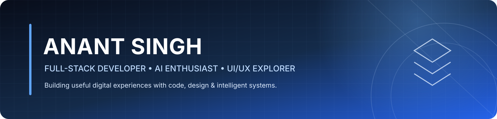

<!--
  Anant Singh | GitHub Profile README
  This is the special profile repository: github.com/sanant456/sanant456
-->

  
   
  
    
  
  
  
    
  

---

## 👋 About Me

I'm a final-year **B.Tech Computer Science & Engineering student** who enjoys building practical software at the intersection of **full-stack development, AI, data, and product design**.

- 💻 I build web applications and experiment with end-to-end product development.
- 🤖 I explore Generative AI, AI agents, and intelligent workflow automation.
- 🎨 I care about clean interfaces, thoughtful UX, and useful details.
- 📊 I enjoy turning raw data into insights and visual stories.
- 🌱 Currently learning, shipping projects, and improving one commit at a time.

---

## ✨ Featured Projects

  
  
  
  

---

## 🛠️ Tech Stack

**Languages**
 

**Frontend & Design**
 

**Backend & Databases**
 

**AI, Data & Tools**
 

  Also exploring: Gemini, OpenAI APIs, Vertex AI, Pandas, NumPy, Matplotlib, Seaborn, Power BI and REST APIs.

---

## 📈 GitHub Activity

  
  
    
  

---

## 🐍 Contribution Graph

  

---

  <h3>💬 Let's Build Something Meaningful</h3>
  
Open to learning, collaborating, and building projects that solve real problems.

  
    
  

