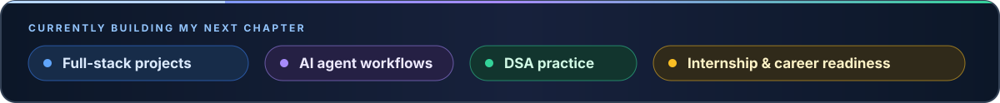
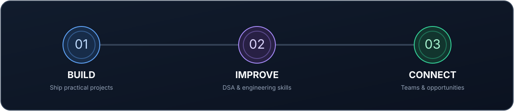

<!-- Anant Singh | GitHub Profile README -->

  
   
  

    <a href="https://www.linkedin.com/in/anant-singh-a5a4a2212/">LinkedIn</a> ·
    <a href="https://leetcode.com/u/sanant567/">LeetCode</a> ·
    <a href="mailto:sanant321@gmail.com">Email</a> ·
    <a href="https://github.com/sanant456/Portfolio">Portfolio</a>
  

---

## 👋 About Me

I'm a **final-year B.Tech Computer Science & Engineering student (2023–2027)** who enjoys turning ideas into useful software. I work across full-stack development, AI-powered applications, data analytics, and UI/UX design.

- 🎓 Preparing for the transition from university projects to real-world engineering.
- 💻 Building full-stack applications and learning how to ship reliable products.
- 🤖 Exploring Generative AI, AI agents, and intelligent workflow automation.
- 🎨 Interested in user-centred interfaces and thoughtful product experiences.
- 🤝 Open to internships, entry-level opportunities, and collaborative projects.

---

  

---

## ✨ Featured Projects

<table>
  <tr>
    <td width="50%" valign="top">
      <h3>🤖 <a href="https://github.com/sanant456/lifeos-ai">LifeOS AI</a></h3>
      
A productivity platform combining task management with specialized AI agents for planning, research, software projects, and workload review.

      
<strong>Stack:</strong> <code>FastAPI</code> <code>Next.js</code> <code>Python</code> <code>SQLite</code>

      <a href="https://github.com/sanant456/lifeos-ai">Explore project →</a>
    </td>
    <td width="50%" valign="top">
      <h3>💳 <a href="https://github.com/sanant456/Subscription-Management-System">SubVault</a></h3>
      
A subscription management and billing platform with lifecycle workflows, invoice generation, payment retries, and operational telemetry.

      
<strong>Stack:</strong> <code>React</code> <code>TypeScript</code> <code>Express</code> <code>PostgreSQL</code>

      <a href="https://github.com/sanant456/Subscription-Management-System">Explore project →</a>
    </td>
  </tr>
  <tr>
    <td width="50%" valign="top">
      <h3>📊 <a href="https://github.com/sanant456/Job-Market-Analysis">MarketPulse</a></h3>
      
A job-market analytics application exploring hiring trends, salary distributions, location insights, and skill gaps.

      
<strong>Stack:</strong> <code>Next.js</code> <code>Firebase</code> <code>Recharts</code>

      <a href="https://github.com/sanant456/Job-Market-Analysis">Explore project →</a>
    </td>
    <td width="50%" valign="top">
      <h3>🛡️ <a href="https://github.com/sanant456/Emergencybridge">EmergencyBridge</a></h3>
      
A patient-controlled emergency record access system with granular consent, responder justification, notifications, and a tamper-evident audit ledger.

      
<strong>Stack:</strong> <code>Next.js</code> <code>SQLite</code> <code>SHA-256</code>

      <a href="https://github.com/sanant456/Emergencybridge">Explore project →</a>
    </td>
  </tr>
</table>

---

## 🧰 Tech Stack

**Languages**  

**Frontend & Design**  

**Backend & Databases**  

**AI, Data & Tools**  

Also exploring Gemini, OpenAI APIs, Vertex AI, Pandas, NumPy, Matplotlib, and Seaborn.

---

## 🎯 My Final-Year Focus

  

---

## 🤝 Let's Connect

  
Interested in collaborating, exchanging ideas, or discussing opportunities?

  
  
  

